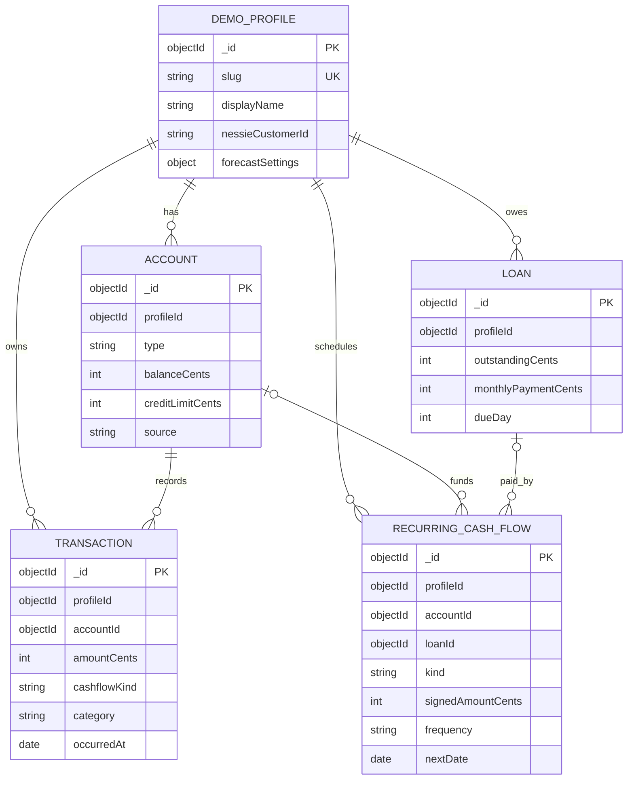

# Engineering — Database Schema, Project Structure & API Design

**Project:** Financial Positioning System (FPS) — HackUTD 2026  
**Status:** Finalized MVP engineering specification — November 7, 2026  
**Primary scope:** PNC 360° Financial Health Navigator + Capital One Nessie synthetic banking data  
**Not in this MVP:** Toyota module, real banking connections, real money movement, authentication

> **Purpose:** This is the shared implementation reference for all three developers. When a field, route, or calculation contract changes, update this file before changing the corresponding code. Product scope comes from `requirements.md`; dependencies come from `techstack.md`; delivery order comes from `phases.md`. Frontend layouts and visual choices belong in the future `design.md`.
>
> **Implementation contract:** The five product/engineering choices in section 9 are finalized. The schema, endpoint naming, validation rules, and directory layout below are the agreed implementation defaults for the MVP; they do **not** imply that the code has already been created. Change this document first if the team deliberately revises the contract.

## 1. Technical Architecture

| Area | Implementation |
| --- | --- |
| Frontend | React + Vite + **JavaScript** |
| UI | Tailwind CSS + shadcn/ui; Recharts for charts |
| Backend | Node.js + Express.js + **JavaScript** |
| Database | MongoDB Atlas + Mongoose |
| External data | Capital One Nessie API; import synthetic banking records into MongoDB; refresh when needed |
| Client/server communication | REST over HTTPS; browser uses native `fetch` |
| Authentication | None — users select one of **exactly three** predefined fictional demo profiles; anyone can edit a profile's balances, recurring flows, loans and spending estimates (section 5.4) |
| Deployment | Render (frontend static site and backend web service) |
| AI explanation | Provider **undecided**; provider-neutral backend adapter and deterministic template fallback |
| Forecast engine | **Finalized:** deterministic daily cash-flow projection; no Monte Carlo/uncertainty engine in MVP |

**Boundary:** React calls only our Express API. Express reads MongoDB, runs financial calculations, and optionally calls Nessie/AI. Never expose the Nessie key, MongoDB URI, or AI key to the browser.


## 2. Monorepo Structure (MVP Contract)

Keep `client/` and `server/` as independently runnable applications under **one GitHub repository**.

```text
Financial-Positioning-System/
├── client/                             # React + Vite; JavaScript
│   ├── public/
│   ├── src/
│   │   ├── main.jsx
│   │   ├── App.jsx
│   │   ├── pages/
│   │   │   ├── Dashboard.jsx
│   │   │   └── Simulator.jsx
│   │   ├── components/
│   │   │   ├── ui/                     # shadcn/ui components
│   │   │   ├── financial/              # balance, account, indicator cards
│   │   │   └── charts/                 # Recharts visualizations
│   │   ├── features/
│   │   │   ├── profiles/
│   │   │   ├── spending/
│   │   │   ├── forecast/
│   │   │   └── scenarios/
│   │   ├── lib/
│   │   │   ├── api.js                  # single fetch wrapper / error handling
│   │   │   ├── money.js                # cents -> formatted display
│   │   │   └── dates.js
│   │   └── styles/
│   ├── .env.example
│   ├── package.json
│   └── vite.config.js
├── server/                             # Express + Mongoose; JavaScript
│   ├── src/
│   │   ├── app.js                      # Express configuration and routes
│   │   ├── index.js                    # connect DB and start HTTP server
│   │   ├── config/
│   │   │   └── db.js
│   │   ├── models/                     # Mongoose models (section 3)
│   │   │   ├── DemoProfile.js
│   │   │   ├── Account.js
│   │   │   ├── Transaction.js
│   │   │   ├── Loan.js
│   │   │   └── RecurringCashFlow.js
│   │   ├── routes/
│   │   │   ├── profiles.routes.js
│   │   │   ├── finances.routes.js
│   │   │   ├── forecast.routes.js
│   │   │   ├── scenarios.routes.js
│   │   │   ├── explanations.routes.js
│   │   │   └── investments.routes.js       # Investment Planner (section 10)
│   │   ├── services/
│   │   │   ├── nessie/                 # Nessie fetch + normalizers
│   │   │   ├── spendingService.js
│   │   │   ├── financialHealthService.js
│   │   │   ├── forecastService.js
│   │   │   ├── scenarioService.js
│   │   │   ├── recommendationService.js
│   │   │   ├── explanationService.js
│   │   │   └── investments/               # investment service + in-memory plan store (section 10)
│   │   ├── engine/
│   │   │   ├── buildCashEvents.js
│   │   │   ├── runDailyForecast.js
│   │   │   ├── evaluateScenario.js
│   │   │   └── investments/               # pure allocation / CD / portfolio math (section 10)
│   │   ├── middleware/
│   │   │   ├── validate.js
│   │   │   └── errorHandler.js
│   │   ├── validators/                # request validation definitions
│   │   └── utils/
│   ├── scripts/
│   │   ├── seedDemoProfiles.js
│   │   └── syncNessie.js
│   ├── tests/
│   │   ├── engine.test.js
│   │   └── api.test.js
│   ├── .env.example
│   └── package.json
├── docs/
│   ├── techstack.md                   # existing
│   ├── requirements.md                # existing
│   ├── phases.md                      # existing
│   ├── engineering.md                 # THIS FILE
│   └── design.md                      # planned, frontend visuals/templates
├── .gitignore
├── package.json                       # optional npm workspace scripts
└── README.md
```

**Conventions:**
- Routes define URL paths, validate input (via `middleware/validate.js`) and respond; there is no separate controllers layer in the MVP. Services implement use cases. `engine/` contains pure calculation functions with no Express or database dependencies.
- Mongoose models describe persistence; **do not** put financial math in route handlers or Mongoose hooks.
- Use ES modules (`import` / `export`) consistently in both applications.
- All new service and API changes should have at least one focused test, especially cash calculations.
- All docs live in `docs/` with **lowercase** filenames (Linux-safe); only `README.md` and `CLAUDE.md` stay at the repo root.
- **Tests:** use Node's built-in `node:test` unless the team picks Vitest at scaffold time; either way the Section 8 invariants are mandatory.

## 3. MongoDB Schema

### 3.1 Relationships

MongoDB documents use Mongoose `ObjectId` references. The following is a **logical** relationship diagram, not SQL foreign-key enforcement.



### 3.2 Collections and Fields

#### `demoProfiles`

Exactly **three** seeded documents, one per selectable **fictional** customer. No password, auth, or user-editable fields. The three profiles should demonstrate distinct financial conditions (for example, stable cash flow, debt pressure, and savings strength); exact fictional names and amounts belong in the seed script, not in the API contract.

| Field | Type | Notes |
| --- | --- | --- |
| `_id` | ObjectId | Primary key |
| `slug` | String | Unique, URL-safe stable demo identifier |
| `displayName` | String | UI label |
| `nessieCustomerId` | String or null | Link to Nessie customer, if applicable |
| `currency` | String | `USD` in MVP |
| `timeZone` | String | Default `America/Chicago` for date scheduling; use profile timezone in calculations |
| `forecastSettings` | Embedded object | `{ asOfDate: "YYYY-MM-DD", historyMonths: 3, cashFloorCents: 0, variableExpenseFrequency: "weekly", categoryOverridesCents: {} }` |
| `lastSyncedAt` | Date or null | Last successful Nessie import |

**Frozen snapshot date:** `forecastSettings.asOfDate` is the snapshot date for all calculations (not the server clock). The seed script sets it and generates every `nextDate` relative to it, so the demo is reproducible on judging day. Scenario dates must be after `asOfDate` and inside the forecast horizon.
| `createdAt`, `updatedAt` | Date | Mongoose timestamps |

#### `accounts`

An account may be sourced from Nessie or supplemented by demo seed data.

| Field | Type | Notes |
| --- | --- | --- |
| `_id`, `profileId` | ObjectId | Profile reference is required |
| `name` | String | E.g. `Checking`, `High-Yield Savings`, `IRA` |
| `type` | String enum | `checking`, `savings`, `credit_card`, `retirement`, `cd`, `investment` |
| `balanceCents` | Integer | Positive asset balance for cash/retirement/investment; **outstanding amount owed** for credit cards |
| `creditLimitCents` | Integer or null | Credit cards only; excluded from available cash |
| `source` | String enum | `nessie`, `supplemental_synthetic` or `user_entered` (created in the app, 5.4) |
| `externalId` | String or null | Original Nessie record ID; use for upsert |
| `asOf` | Date | Timestamp of the represented balance |
| `riskLevel`, `annualRateBps`, `maturityDate`, `holdingsNote` | String enum (`low`/`moderate`/`high`) / Integer bps / `YYYY-MM-DD` / String, all nullable | Optional supplemental investment metadata for CDs and brokerage accounts (section 10); null for Nessie accounts |
| `createdAt`, `updatedAt` | Date | Mongoose timestamps |

**Derived figures (never persist as duplicate source-of-truth fields):**
- `availableCashCents = sum(balanceCents for checking and savings accounts)`.
- `creditCardDebtCents = sum(balanceCents for credit_card accounts)`.
- Retirement, investments, CDs, and credit limits display separately. **Do not add them to spendable cash.**

#### `transactions`

Normalized historical events for expense analysis and cash-flow inference. Store the event **once** even if it appears under multiple Nessie account lookups.

| Field | Type | Notes |
| --- | --- | --- |
| `_id`, `profileId`, `accountId` | ObjectId | Ownership and source account |
| `source`, `externalId` | String | Nessie or synthetic provenance; idempotent upsert key |
| `occurredAt` | Date | Recorded transaction time |
| `description`, `merchantName` | String | Normalized display text |
| `amountCents` | Positive integer | Always nonnegative; direction is modeled separately |
| `cashflowKind` | String enum | `income`, `cash_expense`, `internal_transfer`, `credit_purchase`, `credit_payment`, `loan_payment`, `savings_contribution`, `retirement_contribution` |
| `cashImpactCents` | Signed integer | **Derived by the normalizer** from `cashflowKind` and account types, never hand-entered. Effect on the **combined checking+savings cash balance** at the event date; zero for internal transfers and credit purchases |
| `category` | String enum | `income`, `groceries`, `housing`, `transport`, `utilities`, `entertainment`, `subscriptions`, `health`, `debt`, `savings`, `other` |
| `transferGroupId` | String or null | Groups two sides of a transfer to prevent duplication |
| `isRecurringCandidate` | Boolean | Classification hint, not proof of a future obligation |

**Examples:** A $50 purchase from checking has `cashImpactCents = -5000`; a $50 credit-card purchase has `cashImpactCents = 0` but counts as $50 of category spending. A $200 transfer from checking to savings has a **net combined cash impact of zero**. A $200 transfer from checking to retirement reduces available cash by $200. An actual credit-card payment reduces cash, but must not be added again as a separate spending category.

#### `loans`

Tracks obligations/liabilities; does **not** itself generate an additional forecast debit.

| Field | Type | Notes |
| --- | --- | --- |
| `_id`, `profileId` | ObjectId | Required |
| `name`, `loanType` | String | Loan type: `auto`, `mortgage`, `student`, `personal`, `other` |
| `outstandingCents` | Integer | Current principal/amount due |
| `monthlyPaymentCents` | Integer | For display and validation |
| `dueDay` | Integer (1–31) | Month-end clipping for shorter months |
| `annualRateBps` | Integer or null | Optional; annual rate in basis points |
| `source`, `externalId` | String | `nessie`, `supplemental_synthetic` or `user_entered` (created in the app, 5.4) |

**Forecast rule:** Each loan payment appears exactly once in `recurringCashFlows` as kind `loan_payment`. The seed/sync script must assert that each loan's `monthlyPaymentCents` equals its linked recurring flow, and fail loudly otherwise. The loan document describes the debt; it is not separately subtracted.

#### `recurringCashFlows`

Authoritative **future scheduling inputs** for predictable income and expenses; can be imported from Nessie bills/loans or created as supplemental synthetic facts.

| Field | Type | Notes |
| --- | --- | --- |
| `_id`, `profileId` | ObjectId | Required |
| `name` | String | `Salary`, `Rent`, `Car payment`, `401(k)` |
| `kind` | String enum | `income`, `bill`, `loan_payment`, `credit_card_payment`, `savings_contribution`, `retirement_contribution` |
| `signedAmountCents` | Integer | Cash effect: positive for **net** (take-home) salary; negative for outflows |
| `grossAmountCents` | Integer or null | Income only: gross pay per occurrence, used for debt-payment burden. Seed it explicitly; Nessie deposits are net |
| `frequency` | String enum | `weekly`, `biweekly`, `monthly` |
| `nextDate` | Date | First future scheduled event |
| `endDate` | Date or null | Optional stop date |
| `accountId`, `loanId` | ObjectId or null | References if known |
| `category` | String | Supports category-aware spending views |
| `source`, `externalId` | String | Ingestion provenance / idempotency |
| `active` | Boolean | False excludes flow from projections |

**Credit-card rule:** Existing card debt repayments and *newly forecast card purchase spending* must not represent the same outflow twice. For the initial model, planned variable spending is treated as estimated future cash outflows spread **evenly across each week** (monthly estimate ÷ weeks in month, one event per week), regardless of payment method. **Implementation:** weekly amount = `round(monthlyCents × 12 / 52)`; events fall on `asOf + 7k` days (k ≥ 1). Recurring flows only fire on dates strictly after `asOf`; monthly flows clip to month-end. A single lump-sum day is deliberately avoided because it would make shortfall detection depend on an arbitrary date. An existing card-repayment schedule represents **existing carried balances only**. Explain this simplification in the UI.

### 3.3 Scenarios Are Temporary Request Data (Finalized)

A what-if scenario is an **input to the forecasting engine**, not a real transaction, loan, bill, or account update. `POST /scenarios/evaluate` builds and compares a temporary alternate event stream. Nothing in MongoDB changes. The UI can retain the current inputs/results in React state during the current visit, but a refresh may clear them. **Do not create a `scenarios` MongoDB collection or any save/list/history endpoints in the MVP.** (Investment Planner proposed plans are a separate, documented exception held in server memory only; see 10.4. They never change financial records.)

### 3.4 Indexes and Database Rules

- `demoProfiles.slug`: unique.
- `accounts`: compound index `(profileId, type)` and **partial unique** `(profileId, source, externalId)` where `externalId` exists.
- `transactions`: index `(profileId, occurredAt DESC)`; partial unique `(profileId, source, externalId)` for records with external IDs.
- `loans` and `recurringCashFlows`: index `profileId`; partial unique by `(profileId, source, externalId)` when applicable.
- Every profile-owned query **must** filter by `profileId`. Validate `ObjectId` and whitelist enum values before querying.
- All money is stored as integer **cents**. Never use binary floating-point dollar arithmetic for balances. APR, if present, is integer basis points.
- `source` and `externalId` preserve imported-vs-supplemental provenance; synthetic data must be visibly labeled in the frontend.
- Data refresh uses **upsert**, not wholesale insertion. A failed partial Nessie fetch must not destroy the previous working demo snapshot.
- All three demo profiles and their underlying data are seeded/imported by backend scripts; there are **no public create, edit, or delete endpoints** for profiles, accounts, transactions, loans, or recurring cash flows.
- Demo data is synthetic. Never import actual users' private financial data.

## 4. Financial Calculation Contracts

These **finalized deterministic** rules must be implemented as pure functions in `server/src/engine/` and tested independently of the routes. Identical profile snapshots, dates, and scenario inputs must produce identical results.

1. **As-of snapshot:** Read balances and transactions consistently as of the selected profile snapshot. Show `asOf` and `lastSyncedAt`.
2. **Historical spending:** Group genuine merchant purchases/expenses by category; exclude transfer activity and debt repayments from merchant-spend totals. Estimate monthly variable spending using the recent `historyMonths` window. Subtract recognized fixed obligations and avoid counting them again as variable spending.
3. **Daily projection:** Begin at checking + savings balance; generate dated income, bills, loan repayments, retirement contributions, and estimated variable-expense events for each day through the **sixth forecast checkpoint**. Use the net effect on combined cash; checking-to-savings movements are zero net change. The MVP uses **no stochastic sampling, Monte Carlo simulation, or AI-generated projections**.
4. **Forecast checkpoints:** Return the daily series plus **month-end** snapshots for months 1, 2, 3, and 6. **Fixed convention:** Month 1 is the first future calendar month-end after `asOf`; month 6 is the sixth such month-end. Daily events stop at that sixth checkpoint. Because month 1 may be only a few weeks away, the UI must show each checkpoint's actual date and not label them as exact 30/60/90/180-day horizons. Flag **any day** below `cashFloorCents`, even when its month-end balance recovers.
5. **Scenario comparison:** Clone baseline inputs, add the proposed purchase/recurring commitment, rerun the same algorithm, and return both series, checkpoint deltas, and first shortfall date. **Implementation:** `assessment.riskLevel` is `shortfall` if the scenario has any day below the floor, else `ok`; `monthly_spending_reduction` is modelled as a positive monthly cash flow; `startDate` must be after `asOf`. **Do not modify database records or persist scenario history**.
6. **Health metrics (at least three):**
   - **Emergency coverage:** available cash divided by typical **essential** monthly costs (months; return `null` if denominator is zero). *Essential* = average monthly spend in `housing`, `utilities`, `groceries`, `transport`, `health`, **plus** scheduled monthly debt payments. Entertainment, subscriptions and `other` are discretionary.
   - **Debt-payment burden:** scheduled monthly debt payments divided by expected **monthly gross income** (sum of `grossAmountCents` for income flows, normalized to monthly) (ratio; return `null` if income is zero). Label it as an estimate where income type is uncertain.
   - **Cash-flow safety:** projected minimum daily available cash and count of days below the cash floor over the six-month horizon.
   - **Labels (decided, applied in the client `client/src/lib/health.js`; the API keeps returning raw values):** emergency coverage `< 1` month **at risk**, `1–3` **watch**, `≥ 3` **on track**; debt-payment burden `> 36%` **at risk**, `20–36%` **watch**, `< 20%` **on track**; cash-flow safety: any day below the floor **at risk**, otherwise **on track**. `null` indicators show "not enough data" and do not count as on track.
7. **Recommendations:** Calculate suggestions (e.g., delay by one month, cut discretionary spending by $100/month) by evaluating alternate event streams. Attach numeric before/after changes; never fabricate a saving.
8. **AI:** Keep a **provider-neutral adapter** (e.g. `explain({ subject, facts, assumptions, warnings })`) behind `explanationService.js`; no provider-specific imports should leak into routes or engine code. If a provider is configured later, send only computed metrics, assumptions, warnings, and recommendation results for explanation. The model cannot generate or override balances, debt ratios, forecast points, or affordability decisions. Always provide a deterministic templated explanation when no provider is configured or a call fails.

**Caveat:** A positive six-month cash projection does not establish affordability of a multi-year mortgage or qualify someone for a loan. Forecast outputs are simulations, not guarantees.

## 5. REST API Design

**Base URL:** `/api/v1`  
**Format:** JSON; camelCase fields; money as integer `...Cents` fields; timestamps as ISO 8601; calendar days as `YYYY-MM-DD`.  
**Auth:** `Public demo` for all MVP endpoints because there is no login. Clients may select only one of the **three seeded profile slugs**; profile balances, recurring income/bills, loans and per-category spending estimates are **editable by anyone** through the routes in 5.4 (no login, so any visitor can change shared demo data). `scenarios/evaluate` and `explanations` stay **stateless** and never mutate records or create scenario history. The Investment Planner's plan/decision routes write only to a temporary **in-memory** store (10.4) and never mutate financial records. No public endpoint creates Nessie transactions or resets shared demo records.

### 5.1 Endpoint List

| Method | Path | Purpose | Request | Response |
| --- | --- | --- | --- | --- |
| `GET` | `/api/v1/health` | Service readiness | — | `{ status: "ok" }` |
| `GET` | `/api/v1/profiles` | Populate profile selector | — | `{ profiles: [{ id, slug, displayName, lastSyncedAt }] }` |
| `GET` | `/api/v1/profiles/:slug/overview` | Balances, debt, schedules | — | `{ profile, asOf, cash, accounts, loans, obligations, income }` |
| `GET` | `/api/v1/profiles/:slug/transactions` | History table | `?from=&to=&category=&limit=50` (max 100, newest first) | `{ items }` |
| `GET` | `/api/v1/profiles/:slug/spending` | Category trends & estimated recurring/variable spend | `?months=3` | `{ period, totalCents, byCategory, fixedMonthlyCents, variableMonthlyCents, incomeMonthlyCents, expensesMonthlyCents, netCashFlowMonthlyCents }` |
| `GET` | `/api/v1/profiles/:slug/health-metrics` | Three financial health indicators | — | `{ indicators, assumptions }` |
| `GET` | `/api/v1/profiles/:slug/forecast` | Baseline projections | — | `{ asOf, currency, checkpoints, daily, shortfalls, assumptions }` |
| `POST` | `/api/v1/profiles/:slug/scenarios/evaluate` | Compare a what-if against baseline | Scenario JSON below | `{ baseline, scenario, deltas, assessment, recommendations }` |
| `GET` | `/api/v1/profiles/:slug/recommendations` | Quantified next-best actions | — | `{ recommendations }` |
| `POST` | `/api/v1/profiles/:slug/explanations` | Optional AI / fallback plain-English explanation | `{ subject: "forecast" }` or `{ subject: "scenario", scenario: {...} }` | `{ text, method: "ai" \| "template" }` |
| `GET`/`POST`/`DELETE` | `/api/v1/investments/assumptions`, `/api/v1/profiles/:slug/investments/...` | Investment Planner (portfolio, CDs, allocation simulation, in-memory plans/decisions) | see section 10 | see section 10 |

For all paths above, `:slug` is the seeded profile slug, not a MongoDB ObjectId. The backend resolves the slug to the internal `_id`; all subsequent queries are scoped by that `_id`. Unknown slugs return `404`.

**Implemented route notes (`server/src/routes/profiles.routes.js`, `server/src/services/snapshot.js`) — read first when an endpoint looks wrong:**

- **Implemented:** every route in 5.1, including `POST /explanations` (template only; see below). Smoke-tested live against Atlas for all three profiles; `snapshot.test.js` covers the pure parts.
- **Extra/clarified response fields:** `overview` adds `totals` (`retirementAndInvestmentsCents`, `creditCardDebtCents`, `loanDebtCents`, `creditLimitCents`, `unusedCreditCents`, `netWorthCents`); `spending.byCategory` is an array of `{ category, totalCents }` sorted descending; `health-metrics` returns `{ asOf, indicators: { emergencyCoverage: { months }, debtPaymentBurden: { ratio }, cashFlowSafety: { minCashCents, daysBelowFloor } }, assumptions }`, raw values only (no labels yet); `forecast.assumptions` also carries `historyMonths` and `variableMonthlySpendCents`. `overview.income` lists active income flows `{ name, amountCents (net take-home), grossAmountCents, frequency, nextDate }` sorted by `nextDate` (first = next payday). `spending.incomeMonthlyCents` = active income flows' net amount normalised to monthly; `expensesMonthlyCents` = `fixedMonthlyCents` (bills, loan and card payments) + `variableMonthlyCents`; `netCashFlowMonthlyCents` = income − expenses. Savings/retirement contributions are excluded from expenses (money set aside, not spent). These three ignore `?months` (they come from recurring flows and the `historyMonths` estimate, same as the forecast).
- **Where the engine input comes from (`loadEngine`):** opening cash = checking + savings; flows = active `recurringCashFlows`; variable spend = transactions in the last `historyMonths` that are spending kinds (`cash_expense`, `credit_purchase`) and **not** `isRecurringCandidate`, divided by `historyMonths`, with `categoryOverridesCents` replacing a category. Bills (rent etc.) count in `spending`/emergency-coverage history but not in the variable estimate (they are flows).
- **Variable spend differs slightly from the seed's nominal numbers** (e.g. cash-crunch $802 vs $800/mo) because seed amounts use a noise pattern. Forecast numbers from the API therefore differ by a few dollars from the seed dry-run (cash-crunch first shortfall still 2026-11-20, -$65).
- **Recommendations:** `GET /recommendations` evaluates "spend $100 / $250 less per month from next month" against the baseline, and returns only options that improve month 6 or the lowest cash point. Fixed amounts, not scaled to the shortfall. Each item has a structured `scenario` (a `monthly_spending_reduction` request) so the client can open it in the Simulator; inside `scenarios/evaluate`, `delay_one_month` carries the delayed request (only while the delayed start is on/before the month-6 checkpoint, otherwise `null`) and `cut_discretionary` has `scenario: null`.
- **Errors:** invalid scenario -> `422 INVALID_SCENARIO`; bad query -> `400 VALIDATION_FAILED`; unknown slug -> `404 PROFILE_NOT_FOUND`; any Mongo/Mongoose error name -> `503 DB_UNAVAILABLE` (see `errorHandler.js`). If a route returns 503 right after start, MongoDB had not connected yet (the server listens before connecting).
- **Rate limiting (`middleware/rateLimit.js`, `express-rate-limit`):** per IP, in memory: 60/min on forecast, health-metrics, scenarios/evaluate, recommendations; 10/min on explanations; over the limit -> `429 RATE_LIMITED`. `app.set('trust proxy', 1)` is required on Render (one proxy hop); if every visitor starts getting 429 together, that setting is wrong for the host. Counters reset on restart and are not shared across instances. The dashboard fires several calls in parallel, so if the demo ever shows 429s raise `calcLimit` rather than removing it. Overview/transactions/spending/profiles are not limited.
- **Not done yet:** result caching, request-body validation beyond the engine's own scenario checks (no Zod; hand-written), (`explanations` is the strictest-limit candidate).
- **Explanations (`services/explanationService.js`):** `explain({ subject, facts, assumptions, warnings })` -> `{ text, method: 'template' | 'ai' }`. **No AI provider exists yet**: `adapters` is an empty registry and `AI_PROVIDER` unset/`none`/unknown always yields the template. To add one, register an async function in `adapters` (it must return a string; empty/throwing/over 8 s falls back to the template). Facts passed to a provider are computed numbers only; never pass raw Nessie data or keys. The route builds facts from the engine, so a model can never change a balance or forecast. Scenario text distinguishes a shortfall the scenario *causes* from one the baseline *already has*.
- **Slug is user input** but only used as a string equality filter (`findOne({ slug })`), so no operator injection; query params are whitelisted/parsed before use.

**UI status labels (client presentation only):** `health-metrics` returns raw values; the client labels them without changing them: emergency coverage ≥ 3 months *Healthy*, ≥ 1 *Caution*, else *At risk*; debt-payment burden ≤ 20% *Healthy*, ≤ 36% *Caution*, else *At risk*; cash-flow safety *At risk* if `daysBelowFloor > 0`, *Caution* if `minCashCents` < $1,000, else *Healthy*; `null` → *Not enough data*. Scenario `riskLevel` `shortfall` → *Cash shortfall*, `ok` → *No shortfall*.

**Client data mode:** with `VITE_API_BASE_URL` set the client uses the live API only and shows an error when a request fails (no silent mock substitution). Mocks are used only when `VITE_API_BASE_URL` is unset or the URL has `?mock=1` (`?mock=0` returns to live), and the UI labels that mode. There is no `VITE_USE_MOCKS` flag (replaced by this explicit mode). Profile editing (5.4) is **disabled in mock mode** (fixtures are read-only); after a live edit the client invalidates that profile's cached responses and remounts the page so every view refetches. Client response caches are keyed by data mode and pages remount on a mode switch, so cached mock and live data never mix. Local ports follow the team default (server `5000`, `VITE_API_BASE_URL=http://localhost:5000`; Render sets `PORT`). If `:5000` is taken locally (e.g. macOS AirPlay Receiver), set another `PORT` in your ignored `server/.env` and the matching `VITE_API_BASE_URL` in your ignored `client/.env.local`; do not change the shared defaults.

**Frontend mocks (`client/src/mocks/`):** real responses captured from the synced snapshot by `npm run export:mocks` (`server/scripts/exportMocks.js`): `profiles.json` plus, per slug, `overview`, `transactions` (limit 100), `spending` (3 months), `health-metrics`, `forecast` (174 daily points), `recommendations`, `scenario-one-time` (`{ request, response }` for a $2,000 laptop on 2026-12-01) and `explanation-forecast`. They are a snapshot: if the API shape or seed data changes, re-run the export and commit the diff. Ids are real Mongo ObjectIds; no secrets are present. Served only in explicit mock mode (see "Client data mode"); `mocks/index.js` adds the supplemental holdings (`investment-holdings.json`) until the export contains them and evaluates what-ifs/recommendations with a copy of the server engine (`mocks/engine/`, inputs in `engine-inputs.json`) so mock numbers match live.

### 5.2 Request and Response Examples

**Evaluate a one-time purchase**

```http
POST /api/v1/profiles/early-career/scenarios/evaluate
Content-Type: application/json
```

```json
{
  "type": "one_time",
  "name": "Laptop",
  "amountCents": 200000,
  "startDate": "2026-12-01"
}
```

**Evaluate down payment + monthly commitment**

```json
{
  "type": "down_payment_recurring",
  "name": "New house",
  "downPaymentCents": 1000000,
  "monthlyAmountCents": 300000,
  "startDate": "2027-01-01",
  "durationMonths": 6
}
```

```json
{ "type": "monthly_spending_reduction", "name": "Cut dining out", "monthlyAmountCents": 10000, "category": "entertainment", "startDate": "2026-12-01", "durationMonths": 6 }
```

`durationMonths` specifies how long to inject recurring payments **within the demo forecast** (max 6); this is not a representation of the full loan term. The server always evaluates against the same baseline and horizon. `monthly_spending_reduction` is an **MVP scenario type**, used internally by recommendations and accepted by `evaluate`:

**Illustrative forecast response shape** (numbers are only examples; never hardcode these):

```json
{
  "asOf": "2026-11-07",
  "currency": "USD",
  "checkpoints": [
    { "month": 1, "date": "2026-11-30", "cashCents": 1250000 },
    { "month": 2, "date": "2026-12-31", "cashCents": 1280000 },
    { "month": 3, "date": "2027-01-31", "cashCents": 1200000 },
    { "month": 6, "date": "2027-04-30", "cashCents": 1450000 }
  ],
  "daily": [
    { "date": "2026-11-07", "cashCents": 1180000 }
  ],
  "shortfalls": [],
  "assumptions": {
    "historyMonths": 3,
    "cashFloorCents": 0,
    "forecastMethod": "deterministic_daily_cashflow",
    "variableExpenseFrequency": "weekly"
  }
}
```

**Illustrative scenario comparison response shape:**

```json
{
  "baseline": { "checkpoints": [], "daily": [], "shortfalls": [] },
  "scenario": { "checkpoints": [], "daily": [], "shortfalls": [] },
  "deltas": { "month1Cents": -200000, "month2Cents": -200000, "month3Cents": -200000, "month6Cents": -200000 },
  "assessment": { "riskLevel": "caution", "firstShortfallDate": null, "reasons": [] },
  "recommendations": []
}
```

**Recommendation item:** `{ id, title, action, scenario, impactMonth6Cents, impactMinimumCashCents, explanation, assumptions }`, where impacts come from the engine, not the LLM. `action` is display text. `scenario` is the exact `POST /scenarios/evaluate` body that tries the suggestion on its own (the UI's "Try it"), or `null` when the suggestion only applies on top of the scenario being evaluated (e.g. `cut_discretionary` inside a scenario response).

### 5.4 Profile Editing (added 2026-11-07)

Any visitor can change a profile's inputs; the forecast, health, spending and what-if routes read them on the next request. No login, no history, no undo. Routes in `server/src/routes/edit.routes.js`, body validation in `server/src/services/edits.js` (pure, tested), 30 writes/min per IP (`writeLimit`). `PUT` replaces the whole editable record, so create and update share one validator.

| Method | Path | Body (money in integer cents) | Notes |
| --- | --- | --- | --- |
| `GET` | `/profiles/:slug/editable` | — | `{ asOf, accounts, flows, loans, categoryOverridesCents, categories, spendCategories }`; `flows` = active flows except `loan_payment` |
| `PUT` | `/profiles/:slug/accounts/:id` | `{ name, balanceCents, creditLimitCents? }` | balance must be >= 0 (cards: amount owed); credit limit only on `credit_card`. No account create/delete. |
| `POST` / `PUT` / `DELETE` | `/profiles/:slug/flows[/:id]` | `{ name, kind, amountCents, frequency, nextDate, endDate?, category? }` | `amountCents` > 0; sign comes from `kind` (`income` positive, others negative). `kind` cannot be `loan_payment` (managed through loans). `nextDate` must be after `asOf`. |
| `POST` / `PUT` / `DELETE` | `/profiles/:slug/loans[/:id]` | `{ name, loanType, outstandingCents, monthlyPaymentCents, dueDay (1-28), annualRateBps? }` | Writes the loan **and** its single `loan_payment` flow (`-monthlyPaymentCents`, next `dueDay` after `asOf`), so the payment is still counted once. Delete removes both. |
| `PUT` | `/profiles/:slug/spending-estimates` | `{ categoryOverridesCents: { [category]: cents } }` (`spendCategories` only: no `debt`/`savings`, which are flows) | Replaces `forecastSettings.categoryOverridesCents` (monthly variable spend per category; omitted categories use the transaction-history estimate). |

- New rows get `source: user_entered`. Edited rows keep their source; **`npm run sync:nessie` overwrites edits to Nessie-sourced rows** (upsert by `externalId`), so re-syncing is also the way to reset the demo data.
- Unknown id or an id from another profile -> `404 NOT_FOUND`; bad body -> `400 VALIDATION_FAILED`.
- Transactions stay read-only, so `spending.byCategory` (history) does not change when estimates are overridden; the forecast and `variableMonthlyCents` do.

### 5.3 API Conventions

- **Success:** HTTP `200` for GET/evaluation/updates, `201` for creates, `204` for deletes. Editing routes are limited to 5.4; no CRUD for transactions, profiles or scenarios.
- **Errors:** Consistent shape `{ "error": { "code": "VALIDATION_FAILED", "message": "...", "details": {} } }`.
- **HTTP statuses:** `400` malformed input, `404` unknown demo profile, `422` valid JSON but impossible scenario, `429` throttled, `500` unexpected error, `503` upstream/DB unavailable.
- **Validation:** Use a server-side validation layer (recommended: Zod or an equivalent simple library); never trust client-provided amounts, dates, profile IDs, or claimed computed values.
- **Bounds:** Positive finite integer cents; input dates within a reasonable demo window; monthly scenario amounts nonnegative; six-month maximum scenario horizon; transaction pagination capped (e.g. 100 per page).
- **Caching:** Dashboard data may be fetched in parallel. Forecast/scenario calculations use a consistent stored snapshot; include snapshot timestamps for reproducibility. Never share results across profiles; key any cache by profile and snapshot date.
- **CORS:** Allow only the configured frontend origin(s) on Render. Basic rate limits on forecasting/scenario routes and a stricter one on `/explanations` (the only route that can spend AI quota); never return credentials or raw Nessie API responses.
- **API keys:** Only the backend reads secrets. Browser `.env` has **only** `VITE_API_BASE_URL`.

## 6. Nessie Import Contract

Nessie provides synthetic customer/accounts, deposits, withdrawals, transfers, purchases, bills, loans and merchants. The server adapts those distinct source shapes into the five normalized collections above. Supplementary synthetic records fill gaps (for example, retirement contributions or a mortgage not represented in a given Nessie demo customer).

**Field-source map (verified against the Nessie docs, 2026-11-07).** Base URL `https://api.nessieisreal.com`; auth is an API key (from GitHub login) sent as a `?key=` query parameter, so it is server-only and URLs must never be logged. Customer endpoints let us create/modify data we own; `/enterprise/*` is read-only.

| Our data | Nessie provides? | Source |
| --- | --- | --- |
| Customer name/address | Yes (`first_name`, `last_name`, `address`) | Nessie |
| Checking / savings / credit-card accounts, `balance`, `nickname` | Yes (`type` is only `Checking`, `Savings`, `Credit Card`; `balance` is an integer, treat as whole dollars and convert to cents) | Nessie |
| Credit limit, APR, retirement/IRA/CD/investment accounts | **No** | Supplemental (labeled) |
| Purchases, deposits, withdrawals, transfers | Yes (`medium`, `transaction_date`, `status`, `amount` integer dollars, `description`; purchases also `merchant_id`) | Nessie |
| Spending categories | Partly: merchants have a coarse `category` array (e.g. `["food"]`) | Map merchant category to our enum; housing/utilities come from bills |
| Bills / recurring payments | Yes (`payee`, `payment_amount`, `recurring_date` day-of-month, `upcoming_payment_date`, `status`) | Nessie; monthly only, so weekly/biweekly flows are supplemental |
| Income | **No** field; only deposits (e.g. description "Payroll deposit") | Infer net pay from deposits; `grossAmountCents` supplemental |
| Loans | Partly (`type`, `status`, `amount`, `monthly_payment`, `credit_score`) | Nessie; **outstanding balance, due day, rate are not provided** so supplemental |

**Live-checked with a real key (read-only, 2026-11-07):** IDs are UUID strings (not 24-char ObjectIds), so `externalId` stays a plain String. Merchant `category` is a plain string such as `Groceries`, `Insurance`, `Subscriptions` (not an array as the docs example shows), which maps well to our category enum. Enterprise transfer records contain only `_id`, `transaction_date`, `status`, `amount` and `description`; **no payer/payee**, so `transferGroupId` and checking-to-savings detection must be derived by us (for example from `description` or from the paired account lookups), or we must write the descriptions ourselves when seeding. The shared sandbox holds thousands of other users' customers; never import those, only customers we create under our own key.

**Write-tested with our own key (2026-11-07):**
- Creating customers, Checking/Savings/Credit Card accounts, deposits, purchases, transfers, bills and loans all work, and **back-dated dates are accepted** (so we can seed 3 months of history).
- **Balances are static fields.** Posting deposits, purchases or transfers does *not* change an account's `balance`. The seed script must set balances itself, and the sync must run a reconciliation check against our derived history.
- **Always send `status`.** A purchase POST without `status` returns 201 but poisons every later `GET /accounts/{id}/purchases` for that account with a validation error, and no DELETE route exists. Validate payloads in the seed script before posting.
- **Transfer POST accepts only** `status`, `amount`, `transaction_date`, `description` (no `medium`, `payee_id`, or `payee`). There is no counterparty, so encode it in `description` with a parseable token (e.g. `Transfer to Savings [grp:abc123]`) and derive `internal_transfer`/`transferGroupId` from that. Transfer list responses use `id`, not `_id`.
- Purchases are stored with `type: "merchant"` and `payer_id` = the account; the date field is `purchase_date`. Loans are read via `/accounts/{id}/loans` and carry no account/customer id in the body.
- Credit-card `balance` is stored exactly as posted, so we choose positive = amount owed (matches `accounts.balanceCents`).
- Still unknown: rate limits and how to delete/fix bad records. Use a fresh customer if a probe goes wrong.

**Plan:** because we can POST customer data, `seedDemoProfiles.js` should create our 3 fictional customers, accounts, transactions, bills and loans **in Nessie itself**, then `syncNessie.js` reads them back into MongoDB. That makes Nessie the real source for the banking core. Only the "No" rows above are supplemental. Show "synced from Nessie at <lastSyncedAt>" in the UI and, if possible, run `npm run sync:nessie` live once to prove the integration.

**Nessie client gotchas (`server/src/services/nessie/client.js`) — read first when debugging:**

- **Key leakage:** the key is in the URL. The client throws `NessieError` carrying only the *path*, never the URL, and does not chain the original error (`cause`) because fetch errors can contain the full URL. Never `console.log` a URL or a raw fetch error from Nessie code. A test asserts the key is absent from errors.
- **`status` guard:** `createRecord` refuses to POST purchases/deposits/withdrawals/transfers/bills/loans without `status` (a bad POST permanently poisons that account's GETs; no DELETE exists). If a GET on one account starts failing with a validation error, a record was posted without `status`: use a **fresh customer/account** and re-seed.
- **Transfer whitelist:** transfers accept only `status, amount, transaction_date, description`. Counterparty must be encoded in `description` (e.g. `[grp:abc123]`).
- **IDs:** use `idOf(rec)` (`_id` or `id`); transfer lists use `id`. IDs are UUID strings.
- **Units:** Nessie amounts/balances are whole dollars; use `dollarsToCents` and keep everything else in cents. Credit-card `balance` positive = owed.
- **Date fields differ by resource:** purchases `purchase_date`, others `transaction_date`; bills use `recurring_date` (day of month) and `upcoming_payment_date`.
- **Verified payloads (live POST + read-back, 2026-11-08; all returned 201 `{code, message, objectCreated}`):**
  - customer: `{first_name, last_name, address:{street_number, street_name, city, state, zip}}`
  - account: `{type:'Checking'|'Savings'|'Credit Card', nickname, rewards, balance}` (server adds `account_number`, `customer_id`)
  - deposit / withdrawal: `{medium:'balance', transaction_date:'YYYY-MM-DD', status:'completed', amount, description}`
  - bill: `{status:'recurring', payee, nickname, payment_date, recurring_date (day of month), payment_amount}`
  - loan: `{type:'auto', status:'approved', credit_score, monthly_payment, amount, description}`; `GET /accounts/{id}/loans` returns **no account/customer id**, so track which account a loan was posted to ourselves.
  - The docs page (`prod.nessieisreal.com/docs`) is client-rendered and unreadable by `WebFetch`; verify in a browser. `enterprise/accounts|deposits|bills` time out and `enterprise/withdrawals|loans|purchases` return 403 (use per-account endpoints). `enterprise/customers` returns ~8.9K other users' customers with empty `account_ids`.
- **Server-computed dates use the real clock, not our frozen `asOfDate`:** a bill's `upcoming_payment_date` and every `creation_date` are derived from *today* (probe on 2026-11-08 gave `2026-12-01`). Build `recurringCashFlows.nextDate` from `recurring_date` + `asOfDate`; never copy `upcoming_payment_date`. Treat `creation_date` as meaningless for history.
- **Probe records (ignore, cannot be deleted):** customer `219f40f2-7303-4108-ae26-17138ba8619f` / account `fa0b5032-3c72-4ac4-ba32-fae11458f686` ("Probe Customer"). Never map a demo profile to it.
- **Still not validated:** purchases/transfers payloads beyond the earlier write test (`validateRecord` requires the keys listed in `REQUIRED` in `client.js`).
- **Unknowns:** rate limits (client has a 10 s timeout and no retry/backoff); no pagination handling yet.
- **Env:** needs `NESSIE_API_KEY` (server `.env`, gitignored; see `server/.env.example`). Base URL defaults to `https://api.nessieisreal.com`.
- Tests inject `fetchImpl`; run `npm test` in `server/`. There is no automated live-API test, so run a read-only probe by hand after any change.

**Seed script notes (`server/scripts/`) — read first when the demo numbers look wrong:**

- **Files:** `demoData.js` (the 3 profiles, `ASOF = 2026-11-08`), `seedPlan.js` (pure builder: records + engine flows, tested offline), `seedDemoProfiles.js` (CLI). `npm run seed` is a **dry-run** that validates every payload and prints the forecast/indicators per profile; `npm run seed -- --post` really writes. Posting is **permanent** (no Nessie DELETE).
- **Seeded on 2026-11-08 (do not re-run `--post`):** `steady-saver` `f8482db3-8ca0-4bba-b67c-00e3dc47676c`, `debt-heavy` `9011b99e-4935-4407-a443-bc3e7d594357`, `cash-crunch` `3065929a-7bda-4f8f-a4b5-1f71c8c3764d`. Read-back per customer: checking has deposits/withdrawals/bills/loans/transfers/purchases counts of 7|3 / 18-20 / 4 / 1-2 / 3 / 20, the card has 28 purchases; balances match `demoData.js`. If the numbers in `demoData.js` are changed later, Nessie will NOT update (no DELETE): the sync must either use the new data via a fresh customer or `demoData.js` must be reverted to match what is in Nessie.
- **Retuning:** after editing numbers in `demoData.js`, run the dry-run and `npm test`; `seedPlan.test.js` asserts the contrast (saver: no shortfall; debt-heavy: burden > 25%; cash-crunch: shortfall days while the first month-end is still positive).
- **Idempotency / orphans:** `--post` skips any slug whose `nessieCustomerId` is already in MongoDB. If a post fails mid-way, the script prints an **orphan Nessie customer id** that is *not* saved in MongoDB. Do not re-run blindly (it creates a second customer): record the failure, then fix the cause and re-run (a new customer is created; the orphan is harmless but cannot be deleted).
- **What lives where:** deposits/withdrawals/transfers/purchases/bills/loans and balances go to Nessie. Credit limit and 401(k) are `supplemental` in `demoData.js` (written to MongoDB by the future sync, labeled `supplemental_synthetic`).
- **Account layout:** everything is posted on the **checking** account except card purchases (card account). Loans live on checking (loan GET has no account id); transfers are posted on checking only (description `Transfer to Savings [grp:<slug>-<date>]`), so the savings side has no matching record: sync must derive both sides from the token.
- **Classification the sync must apply (from descriptions):** `Payroll deposit` -> income; `Bill: <nickname>` -> bill (category from the bill, see `demoData.js`); `Loan payment: <name>` -> loan_payment; `Credit card payment [card]` -> credit_payment; `[grp:...]` -> internal_transfer. Merchants are **Kroger** (groceries), **Shell** (transport), **Chipotle** (dining), **Arcade Alley** (entertainment) by fixed ids; the sandbox's merchant categories are inconsistent (`Groceries`/`groceries`/`Grocery`, `Dining`/`dining`/`Eating out`), so map by merchant, not by raw category string.
- **Engine inputs vs. transfers:** the checking->savings transfer is **not** an engine flow (net cash change is zero). Card purchases are inside `variableMonthlySpendCents`; the card payment flow only covers the carried balance (no double count).
- **Deterministic:** purchase amounts use a fixed 5-value pattern, never `Math.random`. Monthly days must stay <= 28.
- **Dates:** all history is back-dated 91 days from `ASOF`; Nessie `creation_date` will show the real posting day and must be ignored.
- **Known quirk:** `cash-crunch` runs about 100 days below $0 in the horizon (min about -$1.9k) because pay is monthly (28th) and outflows are front-loaded; soften `spend` or `bills` in `demoData.js` if that looks too extreme on stage.

**Sync notes (`server/scripts/syncNessie.js`, `server/src/services/nessie/normalize.js`) — read first when MongoDB data looks wrong:**

- **Run:** `npm run sync:nessie` (add `-- --dry` to fetch and check without writing). It reads each `demoProfiles` row that has a `nessieCustomerId`. Safe to re-run: it upserts by `(profileId, source, externalId)`; verified that two runs leave identical counts (steady-saver 76 tx, debt-heavy 78, cash-crunch 72).
- **Two phases:** fetch + normalize + checks for **all** profiles first; DB writes only if everything passed, so a Nessie failure keeps the previous snapshot. `lastSyncedAt` is set per profile only after its writes finish.
- **Checks that abort the sync (`issues`):** a deposit/withdrawal description it does not recognize, a transfer without a `[grp:...]` token, an unknown merchant id, a loan without supplemental terms, or a loan whose `monthly_payment` differs from its latest `Loan payment:` withdrawal (the "seed fails loudly" rule). If a new record type is ever seeded, add its classification in `normalize.js` first.
- **Supplemental fields (labeled):** credit limit (on the card account), 401(k) account (`source: supplemental_synthetic`, externalId `<slug>:401k`), Investment Planner holdings from `supplemental.investments` (CDs/brokerage, externalId `<slug>:<key>`, section 10), gross pay, loan `dueDay` and `annualRateBps`, bill categories. Source of truth is `scripts/demoData.js`. Note the credit-card and loan rows keep `source: nessie` even though some fields are supplemental.
- **Derived, not provided:** income frequency (all deposit gaps <= 15 days -> biweekly, else monthly) and amount (latest deposit); card-payment flow (latest `Credit card payment` withdrawal); `nextDate` for bills/loans/card payment comes from the day-of-month plus `asOfDate`, never Nessie's `upcoming_payment_date`.
- **Not created on purpose:** no recurring flow for the checking->savings transfer (zero net cash); card purchases are `credit_purchase` with `cashImpactCents = 0`.
- **No deletes:** the sync only upserts, so a record removed from Nessie would linger in MongoDB. Nessie has no DELETE and the seed is final, so this is acceptable; if data is ever re-seeded, clear the profile's collections first (with confirmation).
- **Category mapping:** merchant key -> category: groceries->groceries, transport->transport, entertainment->entertainment, dining->`other` (no dining category in the enum; counts as discretionary). `occurredAt` is stored at 12:00 UTC so the calendar day survives timezones.
- **Check:** `scripts/syncNormalize.test.js` rebuilds fake Nessie responses from the seed plan and asserts the synced flows equal the seed plan's engine flows. Feeding the synced flows into `forecast()` reproduces the dry-run numbers (first shortfall 2026-11-20 / 2027-03-09 / none; month-6 cash $1139 / $606 / $22518).

**Suggested import order:**

1. Create or find a `demoProfiles` row by stable `slug`, mapping to `nessieCustomerId`.
2. Fetch customer accounts; upsert `accounts` by `(profileId, source, externalId)`.
3. Fetch account-linked purchases, deposits, withdrawals, transfers, and relevant bills/loans; deduplicate on source IDs and normalize dates, cents, categories, and cash-impact kinds.
4. Upsert `transactions`, `loans`, and `recurringCashFlows`; apply supplemental synthetic seed records only to data fields not provided for that demo profile.
5. Verify cash reconciliation and scheduling assumptions; set `lastSyncedAt` only when the import succeeds.

**Default workflow:** `npm run seed` and `npm run sync:nessie` executed on the **server** via CLI/script. No public `POST /sync` route. Keep previously seeded data available if Nessie is unreachable during judging.

**Official Nessie reference:** https://prod.nessieisreal.com/docs — verify the exact payload properties and endpoint URLs there before implementing individual adapter functions. In particular, do not assume that a Nessie loan, bill, or purchase has exactly the same fields as our normalized model.

## 7. Environment Variables

| Variable | Used by | Required? |
| --- | --- | --- |
| `VITE_API_BASE_URL` | Client | Yes; public Express base URL |
| `PORT` | Server | Provided by Render; local fallback allowed |
| `MONGODB_URI` | Server | Yes |
| `NESSIE_API_KEY` | Server ingestion script | Yes for Nessie import |
| `NESSIE_BASE_URL` | Server ingestion script | Optional; use documented Nessie URL |
| `CLIENT_ORIGIN` | Server CORS | Yes in deployment |
| `AI_PROVIDER` | Server optional AI adapter | Optional; omitted/`none` uses template fallback |
| `AI_API_KEY` | Server optional AI adapter | Only after a provider is chosen and enabled |
| `AI_MODEL` | Server optional AI adapter | Only after selecting provider/model |

Commit `.env.example` files but **never** commit real `.env` files or API keys. API keys must not use a `VITE_` prefix.

## 8. Minimum Tests Before Demo

- Same transfer between checking and savings does not alter total available cash.
- Credit limit and retirement balance do not increase available cash.
- Loan payment is subtracted once, even when both `loans` and `recurringCashFlows` contain its details.
- Credit-card merchant spending and the cash payment settling it are not counted twice.
- Month-end balance may be positive while an earlier daily balance is negative; a shortfall must still appear.
- One-time expense affects forecast only on/after its start date; recurring expense repeats at expected dates.
- `POST /scenarios/evaluate` does **not** change any database account/transaction/loan records.
- Re-running Nessie ingestion does not duplicate records.
- Identical profile snapshots, as-of dates, and scenario inputs produce identical forecasts on repeated requests.
- Seed script fails if a loan's payment and its recurring flow disagree.
- Exactly three distinct selectable demo profiles exist; each resolves consistently by slug and cannot be edited through the API.
- A scenario exists only in the evaluation request/response or current client memory; a subsequent profile read shows unchanged financial data and no saved scenario history.
- An unconfigured/failed AI provider uses a safe deterministic template-based explanation rather than crashing the demo.
- API returns a predictable error for invalid profile slug, scenario amounts, and dates.
- Investment Planner: allocations total exactly 100%; liquid cash never appears in the portfolio total; supplemental CDs/brokerage leave cash-flow results unchanged; approvals report `executed: false` and change no balance; plans reset when the store is cleared.

## 9. Finalized Engineering Decisions

These decisions have been confirmed for the HackUTD MVP. They are **not open questions** and should be used as acceptance criteria for implementation.

| Decision | Final choice | Consequence for implementation |
| --- | --- | --- |
| Demo profiles | **Exactly 3 fictional customers** | Seed three distinct, selectable profiles. No login, registration, or other customer creation flow. |
| Manual data editing | **Yes (changed 2026-11-07)** | Any visitor can edit a profile's balances, income/bills, loans and spending estimates (5.4). Transactions stay read-only. Supersedes the earlier "read-only" decision. |
| Forecast method | **Deterministic daily projection** | Reusable pure functions, dated cash-flow events, month-end checkpoints, daily shortfall detection. No probabilistic engine in MVP. |
| Scenario storage | **Temporary only** | Compute baseline versus what-if in memory; do not persist scenarios or alter stored financial records. |
| AI provider | **Undecided, provider-neutral interface** | Explanation service exposes a stable internal contract and template fallback. Do not bind the architecture to Gemini, OpenAI, or another provider until selected. |

**No additional engineering decisions are required to begin the MVP.** If a new choice becomes necessary during development, document it here and keep the corresponding routes, models, tests, and `phases.md` consistent.

**Engineering priority:** Ship **Nessie → MongoDB → three editable demo profiles → deterministic forecast → temporary what-if comparison → quantified recommendation**, with provider-neutral explanations and a reliable fallback, before adding optional features.

## 10. Investment Planner (Approved Extension)

Team-approved addition (2026-11-07; integrated with the canonical MongoDB profiles 2026-11-08) on top of the PNC MVP. It explains **long-term holdings** (investments, retirement accounts, CDs) separately from spendable cash and lets a user try **hypothetical** allocations. It never executes trades, transfers, CD renewals, or notifications.

### 10.1 Rules

- **Separate from cash:** investment, retirement and CD balances are never added to `availableCashCents`. The portfolio response reports liquid cash in its own `liquidCash` field and excludes it from `totalLongTermCents`.
- **Hypothetical, labeled assumptions:** returns, volatility, stress shocks and the CD renewal rate are fixed synthetic numbers in `server/src/engine/investments/assumptions.js`, returned by `GET /investments/assumptions` and echoed in each simulation (`assumptions`). They are not market data, forecasts, or advice. Every response carries a `disclaimer`.
- **Server-side math:** pure functions in `server/src/engine/investments/` (no Express/Mongo). Money is integer cents, rates are integer basis points, allocations are integer percents that must total exactly 100.
- **Deterministic:** same inputs → same outputs. Yearly values are `round(amountCents × (1 + r)^year)` with `r` the allocation-weighted scenario return; no randomness.
- **No execution:** approval only records a decision. Every plan/decision response includes `executed: false`.
- **Data source:** holdings are the profile's `accounts` documents, read through `services/snapshot.js` `loadSnapshot(slug)` (the same read the Dashboard overview uses), so balances, names, `asOf` and totals always match `GET /overview`. Profiles are the canonical slugs `cash-crunch`, `debt-heavy`, `steady-saver`.
- **Supplemental holdings:** CDs and brokerage accounts are **supplemental synthetic** (Nessie has none). They are defined in `scripts/demoData.js` (`supplemental.investments`), turned into accounts by `services/nessie/normalize.js` (externalId `<slug>:<key>`, `source: "supplemental_synthetic"`), and written by the normal `npm run sync:nessie` upsert. The existing 401(k) (`<slug>:401k`) is unchanged and has no `riskLevel`, so it is shown as "moderate (assumed)". Optional `Account` fields used here: `riskLevel`, `annualRateBps`, `maturityDate`, `holdingsNote` (null for Nessie cash/credit accounts). They are display/scheduling metadata, never cash.
- **Profile edits (5.4):** editing an account (`PUT /profiles/:slug/accounts/:id`, name/balance/limit only) changes what the Planner shows on the next read, and its investment metadata is kept. Edits never create investment accounts; supplemental holdings come only from the sync.
- **Effect on other numbers:** none on cash flow (opening cash is checking + savings only; no recurring flows are added). `overview.totals.retirementAndInvestmentsCents` and `netWorthCents` include the new holdings, exactly like the 401(k).
- **Code:** `routes/investments.routes.js` (thin; `createInvestmentRouter({ loadSnapshot })` for tests), `services/investments/investmentService.js`, `services/investments/planStore.js`, `validators/investments.js`, pure `engine/investments/*`. Tests: `engine/investments/investments.test.js`, `routes/investments.routes.test.js` (canonical `demoData.js` profiles, no MongoDB). Rate limit: `calcLimit` on simulate and plan save.

### 10.2 Endpoints

All under `/api/v1`. Unknown slug → `404 PROFILE_NOT_FOUND` (from `loadSnapshot`); bad input → `400 VALIDATION_FAILED` with `details.field`; unknown plan/CD → `404 PLAN_NOT_FOUND` / `CD_NOT_FOUND`; deciding an already-decided plan → `409 PLAN_ALREADY_DECIDED`.

| Method | Path | Notes |
| --- | --- | --- |
| `GET` | `/investments/assumptions` | Global, not profile-specific |
| `GET` | `/profiles/:slug/investments/portfolio` | Pie groups + per-account detail |
| `GET` | `/profiles/:slug/investments/cds` | Sorted by maturity; includes stored decisions |
| `POST` | `/profiles/:slug/investments/allocations/simulate` | Stateless |
| `GET` / `POST` | `/profiles/:slug/investments/plans` | List / save (`201`), max 20 plans per profile |
| `POST` | `/profiles/:slug/investments/plans/:planId/decision` | `pending` → `approved` \| `rejected` only |
| `DELETE` | `/profiles/:slug/investments/plans/:planId` | |
| `POST` / `DELETE` | `/profiles/:slug/investments/cds/:accountId/decision` | `action`: `move_to_savings` \| `renew_12` \| `decide_later` |

**Request bounds:** `allocation` = `{ usStocks, intlStocks, bonds, cdsCash }`, each an integer 0–100, summing to 100. `amountCents` positive integer ≤ 1,000,000,000 (≤ $10M). `years` integer 1–30. Plan `name` ≤ 60 characters (default generated).

### 10.3 Response Shapes

```json
// GET /profiles/steady-saver/investments/portfolio   (account ids are Mongo ObjectId strings)
{
  "profile": { "slug": "steady-saver", "displayName": "Maya Chen" },
  "asOf": "2026-11-08",
  "liquidCash": { "availableCashCents": 1750000, "includedInPortfolio": false, "note": "Checking + savings ..." },
  "totalLongTermCents": 3970000,
  "groups": [
    { "id": "investment", "label": "Investments", "totalCents": 420000, "shareBps": 1058, "accountIds": ["..."] },
    { "id": "retirement", "label": "Retirement", "totalCents": 2800000, "shareBps": 7053, "accountIds": ["..."] },
    { "id": "cd", "label": "CDs", "totalCents": 750000, "shareBps": 1889, "accountIds": ["...", "..."] }
  ],
  "accounts": [
    { "id": "...", "name": "12-Month CD", "type": "cd", "group": "cd", "balanceCents": 500000,
      "riskLevel": "low", "riskLabel": "Low risk", "riskIsAssumed": false, "riskNote": "...",
      "annualRateBps": 425, "maturityDate": "2027-02-15", "daysToMaturity": 99, "holdingsNote": null,
      "source": "supplemental_synthetic" }
  ],
  "disclaimer": "..."
}
```

```json
// POST /profiles/:slug/investments/allocations/simulate
// body { "allocation": { "usStocks": 45, "intlStocks": 15, "bonds": 30, "cdsCash": 10 }, "amountCents": 1000000, "years": 10 }
{
  "input": { "allocation": {}, "amountCents": 1000000, "years": 10 },
  "risk": { "volatilityBps": 1175, "band": "elevated", "label": "Elevated" },
  "scenarios": [ { "id": "base", "label": "Middle case", "annualReturnBps": 541, "finalValueCents": 1693628 } ],
  "projection": [ { "year": 0, "low": 1000000, "base": 1000000, "high": 1000000 } ],
  "stress": { "shockBps": -1980, "lossCents": -198000 },
  "assumptions": { "label": "Hypothetical", "assetClasses": [], "returnScenarios": [] },
  "disclaimer": "..."
}
```

```json
// GET /profiles/:slug/investments/cds
{
  "asOf": "2026-11-08",
  "reminderLeadDays": 14,
  "cds": [
    { "accountId": "...", "name": "6-Month CD", "principalCents": 250000, "annualRateBps": 410,
      "maturityDate": "2026-12-12", "daysToMaturity": 34, "reminderDate": "2026-11-28", "status": "upcoming",
      "options": [
        { "id": "move_to_savings", "label": "Move to high-yield savings", "addsToAvailableCashCents": 250000, "effectiveDate": "2026-12-12" },
        { "id": "renew_12", "label": "Renew for 12 months", "hypotheticalRateBps": 375, "estimatedInterestCents": 9375, "addsToAvailableCashCents": 0 },
        { "id": "decide_later", "label": "Decide closer to the date", "addsToAvailableCashCents": 0 }
      ],
      "decision": null }
  ],
  "storage": { "type": "memory", "resetsOnRestart": true, "note": "..." },
  "disclaimer": "..."
}
```

`accountId` is the account's Mongo `_id` string. `status` is `upcoming` (> 30 days), `due_soon` (0–30 days) or `matured` (< 0). CDs without a `maturityDate` are listed in `undatedCds` instead.

**Plan object:** `{ id, name, status: "pending" | "approved" | "rejected", allocation, amountCents, years, risk, scenarios, createdAt, decidedAt, executed: false }`. **CD decision object:** `{ accountId, action, decision: "approved" | "rejected", decidedAt, executed: false }`.

### 10.4 Temporary Plan Storage (MVP)

Proposed plans and CD decisions live in a **process-memory** store (`services/investments/planStore.js`), keyed by profile slug. There is **no Mongo collection**. Consequences, which the UI must state:

- **Everything resets when the server restarts or redeploys** (Render restarts included), and multiple server instances would not share it.
- Every viewer of the public demo shares the same store for a given profile.
- "Move to savings" approval does **not** change balances or the cash forecast; it is a recorded intent only.
- Each list/save/decision response includes `storage: { type: "memory", resetsOnRestart: true, note }`.

Promoting plans to a persisted collection is a deliberate future change and must update this section first.
