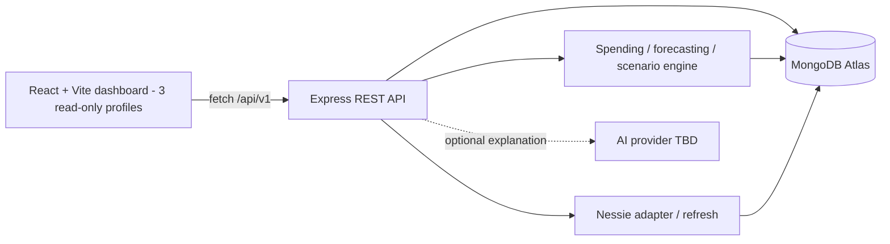
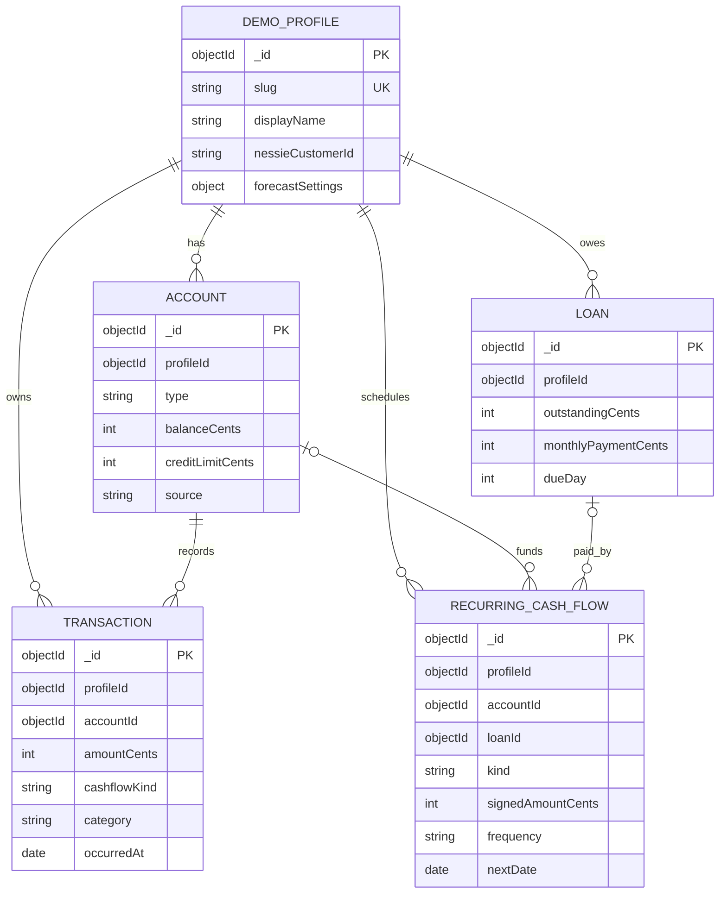

# Engineering — Database Schema, Project Structure & API Design

**Project:** Financial Positioning System (FPS) — HackUTD 2026  
**Status:** Finalized MVP engineering specification — November 7, 2026  
**Primary scope:** PNC 360° Financial Health Navigator + Capital One Nessie synthetic banking data  
**Not in this MVP:** Toyota module, real banking connections, real money movement, authentication

> **Purpose:** This is the shared implementation reference for all three developers. When a field, route, or calculation contract changes, update this file before changing the corresponding code. Product scope comes from `requirements.md`; dependencies come from `TechStack.md`; delivery order comes from `Phases.md`. Frontend layouts and visual choices belong in the future `design.md`.
>
> **Implementation contract:** The five product/engineering choices in section 9 are finalized. The schema, endpoint naming, validation rules, and directory layout below are the agreed implementation defaults for the MVP; they do **not** imply that the code has already been created. Change this document first if the team deliberately revises the contract.

## 1. Technical Architecture

| Area | Implementation |
| --- | --- |
| Frontend | React + Vite + **JavaScript** |
| UI | Tailwind CSS + shadcn/ui; Recharts for charts |
| Backend | Node.js + Express.js + **JavaScript** |
| Database | MongoDB Atlas + Mongoose |
| External data | Capital One Nessie API; import synthetic banking records into MongoDB; refresh when needed |
| Client/server communication | REST over HTTPS; browser uses native `fetch` |
| Authentication | None — users select one of **exactly three** predefined fictional demo profiles; no profile editing |
| Deployment | Render (frontend static site and backend web service) |
| AI explanation | Provider **undecided**; provider-neutral backend adapter and deterministic template fallback |
| Forecast engine | **Finalized:** deterministic daily cash-flow projection; no Monte Carlo/uncertainty engine in MVP |

**Boundary:** React calls only our Express API. Express reads MongoDB, runs financial calculations, and optionally calls Nessie/AI. Never expose the Nessie key, MongoDB URI, or AI key to the browser.



## 2. Monorepo Structure (MVP Contract)

Keep `client/` and `server/` as independently runnable applications under **one GitHub repository**.

```text
Financial-Positioning-System/
├── client/                             # React + Vite; JavaScript
│   ├── public/
│   ├── src/
│   │   ├── main.jsx
│   │   ├── App.jsx
│   │   ├── pages/
│   │   │   ├── Dashboard.jsx
│   │   │   └── Simulator.jsx
│   │   ├── components/
│   │   │   ├── ui/                     # shadcn/ui components
│   │   │   ├── financial/              # balance, account, indicator cards
│   │   │   └── charts/                 # Recharts visualizations
│   │   ├── features/
│   │   │   ├── profiles/
│   │   │   ├── spending/
│   │   │   ├── forecast/
│   │   │   └── scenarios/
│   │   ├── lib/
│   │   │   ├── api.js                  # single fetch wrapper / error handling
│   │   │   ├── money.js                # cents -> formatted display
│   │   │   └── dates.js
│   │   └── styles/
│   ├── .env.example
│   ├── package.json
│   └── vite.config.js
├── server/                             # Express + Mongoose; JavaScript
│   ├── src/
│   │   ├── app.js                      # Express configuration and routes
│   │   ├── index.js                    # connect DB and start HTTP server
│   │   ├── config/
│   │   │   └── db.js
│   │   ├── models/                     # Mongoose models (section 3)
│   │   │   ├── DemoProfile.js
│   │   │   ├── Account.js
│   │   │   ├── Transaction.js
│   │   │   ├── Loan.js
│   │   │   └── RecurringCashFlow.js
│   │   ├── routes/
│   │   │   ├── profiles.routes.js
│   │   │   ├── finances.routes.js
│   │   │   ├── forecast.routes.js
│   │   │   ├── scenarios.routes.js
│   │   │   └── explanations.routes.js
│   │   ├── controllers/               # HTTP input/output only
│   │   ├── services/
│   │   │   ├── nessie/                 # Nessie fetch + normalizers
│   │   │   ├── spendingService.js
│   │   │   ├── financialHealthService.js
│   │   │   ├── forecastService.js
│   │   │   ├── scenarioService.js
│   │   │   ├── recommendationService.js
│   │   │   └── explanationService.js
│   │   ├── engine/
│   │   │   ├── buildCashEvents.js
│   │   │   ├── runDailyForecast.js
│   │   │   └── evaluateScenario.js
│   │   ├── middleware/
│   │   │   ├── validate.js
│   │   │   └── errorHandler.js
│   │   ├── validators/                # request validation definitions
│   │   └── utils/
│   ├── scripts/
│   │   ├── seedDemoProfiles.js
│   │   └── syncNessie.js
│   ├── tests/
│   │   ├── engine.test.js
│   │   └── api.test.js
│   ├── .env.example
│   └── package.json
├── docs/
│   ├── TechStack.md                   # existing; retain spelling/case
│   ├── requirements.md                # existing
│   ├── Phases.md                      # existing
│   ├── engineering.md                 # THIS FILE
│   └── design.md                      # planned, frontend visuals/templates
├── .gitignore
├── package.json                       # optional npm workspace scripts
└── README.md
```

**Conventions:**
- Routes define URL paths. Controllers parse/validate and respond. Services implement use cases. `engine/` contains pure calculation functions with no Express or database dependencies.
- Mongoose models describe persistence; **do not** put financial math in route handlers or Mongoose hooks.
- Use ES modules (`import` / `export`) consistently in both applications.
- All new service and API changes should have at least one focused test, especially cash calculations.
- If your three existing Markdown files currently live at repository root, keep them there and place `engineering.md` beside them; the `docs/` tree above is a **suggested eventual layout**, not a required move.

## 3. MongoDB Schema

### 3.1 Relationships

MongoDB documents use Mongoose `ObjectId` references. The following is a **logical** relationship diagram, not SQL foreign-key enforcement.



### 3.2 Collections and Fields

#### `demoProfiles`

Exactly **three** seeded documents, one per selectable **fictional** customer. No password, auth, or user-editable fields. The three profiles should demonstrate distinct financial conditions (for example, stable cash flow, debt pressure, and savings strength); exact fictional names and amounts belong in the seed script, not in the API contract.

| Field | Type | Notes |
| --- | --- | --- |
| `_id` | ObjectId | Primary key |
| `slug` | String | Unique, URL-safe stable demo identifier |
| `displayName` | String | UI label |
| `nessieCustomerId` | String or null | Link to Nessie customer, if applicable |
| `currency` | String | `USD` in MVP |
| `timeZone` | String | Default `America/Chicago` for date scheduling; use profile timezone in calculations |
| `forecastSettings` | Embedded object | `{ historyMonths: 3, cashFloorCents: 0, variableExpenseDay: 20, categoryOverridesCents: {} }` |
| `lastSyncedAt` | Date or null | Last successful Nessie import |
| `createdAt`, `updatedAt` | Date | Mongoose timestamps |

#### `accounts`

An account may be sourced from Nessie or supplemented by demo seed data.

| Field | Type | Notes |
| --- | --- | --- |
| `_id`, `profileId` | ObjectId | Profile reference is required |
| `name` | String | E.g. `Checking`, `High-Yield Savings`, `IRA` |
| `type` | String enum | `checking`, `savings`, `credit_card`, `retirement`, `cd`, `investment` |
| `balanceCents` | Integer | Positive asset balance for cash/retirement/investment; **outstanding amount owed** for credit cards |
| `creditLimitCents` | Integer or null | Credit cards only; excluded from available cash |
| `source` | String enum | `nessie` or `supplemental_synthetic` |
| `externalId` | String or null | Original Nessie record ID; use for upsert |
| `asOf` | Date | Timestamp of the represented balance |
| `createdAt`, `updatedAt` | Date | Mongoose timestamps |

**Derived figures (never persist as duplicate source-of-truth fields):**
- `availableCashCents = sum(balanceCents for checking and savings accounts)`.
- `creditCardDebtCents = sum(balanceCents for credit_card accounts)`.
- Retirement, investments, CDs, and credit limits display separately. **Do not add them to spendable cash.**

#### `transactions`

Normalized historical events for expense analysis and cash-flow inference. Store the event **once** even if it appears under multiple Nessie account lookups.

| Field | Type | Notes |
| --- | --- | --- |
| `_id`, `profileId`, `accountId` | ObjectId | Ownership and source account |
| `source`, `externalId` | String | Nessie or synthetic provenance; idempotent upsert key |
| `occurredAt` | Date | Recorded transaction time |
| `description`, `merchantName` | String | Normalized display text |
| `amountCents` | Positive integer | Always nonnegative; direction is modeled separately |
| `cashflowKind` | String enum | `income`, `cash_expense`, `internal_transfer`, `credit_purchase`, `credit_payment`, `loan_payment`, `savings_contribution`, `retirement_contribution` |
| `cashImpactCents` | Signed integer | Effect on the **combined checking+savings cash balance** at the event date; zero for internal transfers and credit purchases |
| `category` | String enum | `income`, `groceries`, `housing`, `transport`, `utilities`, `entertainment`, `subscriptions`, `health`, `debt`, `savings`, `other` |
| `transferGroupId` | String or null | Groups two sides of a transfer to prevent duplication |
| `isRecurringCandidate` | Boolean | Classification hint, not proof of a future obligation |

**Examples:** A $50 purchase from checking has `cashImpactCents = -5000`; a $50 credit-card purchase has `cashImpactCents = 0` but counts as $50 of category spending. A $200 transfer from checking to savings has a **net combined cash impact of zero**. A $200 transfer from checking to retirement reduces available cash by $200. An actual credit-card payment reduces cash, but must not be added again as a separate spending category.

#### `loans`

Tracks obligations/liabilities; does **not** itself generate an additional forecast debit.

| Field | Type | Notes |
| --- | --- | --- |
| `_id`, `profileId` | ObjectId | Required |
| `name`, `loanType` | String | Loan type: `auto`, `mortgage`, `student`, `personal`, `other` |
| `outstandingCents` | Integer | Current principal/amount due |
| `monthlyPaymentCents` | Integer | For display and validation |
| `dueDay` | Integer (1–31) | Month-end clipping for shorter months |
| `annualRateBps` | Integer or null | Optional; annual rate in basis points |
| `source`, `externalId` | String | `nessie` or `supplemental_synthetic` |

**Forecast rule:** Each loan payment appears exactly once in `recurringCashFlows` as kind `loan_payment`. The loan document describes the debt; it is not separately subtracted.

#### `recurringCashFlows`

Authoritative **future scheduling inputs** for predictable income and expenses; can be imported from Nessie bills/loans or created as supplemental synthetic facts.

| Field | Type | Notes |
| --- | --- | --- |
| `_id`, `profileId` | ObjectId | Required |
| `name` | String | `Salary`, `Rent`, `Car payment`, `401(k)` |
| `kind` | String enum | `income`, `bill`, `loan_payment`, `credit_card_payment`, `savings_contribution`, `retirement_contribution` |
| `signedAmountCents` | Integer | Positive for salary; negative for cash outflows |
| `frequency` | String enum | `weekly`, `biweekly`, `monthly` |
| `nextDate` | Date | First future scheduled event |
| `endDate` | Date or null | Optional stop date |
| `accountId`, `loanId` | ObjectId or null | References if known |
| `category` | String | Supports category-aware spending views |
| `source`, `externalId` | String | Ingestion provenance / idempotency |
| `active` | Boolean | False excludes flow from projections |

**Credit-card rule:** Existing card debt repayments and *newly forecast card purchase spending* must not represent the same outflow twice. For the initial model, planned variable spending is treated as one estimated future cash outflow on its configured settlement day, regardless of payment method. An existing card-repayment schedule represents **existing carried balances only**. Explain this simplification in the UI.

### 3.3 Scenarios Are Temporary Request Data (Finalized)

A what-if scenario is an **input to the forecasting engine**, not a real transaction, loan, bill, or account update. `POST /scenarios/evaluate` builds and compares a temporary alternate event stream. Nothing in MongoDB changes. The UI can retain the current inputs/results in React state during the current visit, but a refresh may clear them. **Do not create a `scenarios` MongoDB collection or any save/list/history endpoints in the MVP.**

### 3.4 Indexes and Database Rules

- `demoProfiles.slug`: unique.
- `accounts`: compound index `(profileId, type)` and **partial unique** `(profileId, source, externalId)` where `externalId` exists.
- `transactions`: index `(profileId, occurredAt DESC)`; partial unique `(profileId, source, externalId)` for records with external IDs.
- `loans` and `recurringCashFlows`: index `profileId`; partial unique by `(profileId, source, externalId)` when applicable.
- Every profile-owned query **must** filter by `profileId`. Validate `ObjectId` and whitelist enum values before querying.
- All money is stored as integer **cents**. Never use binary floating-point dollar arithmetic for balances. APR, if present, is integer basis points.
- `source` and `externalId` preserve imported-vs-supplemental provenance; synthetic data must be visibly labeled in the frontend.
- Data refresh uses **upsert**, not wholesale insertion. A failed partial Nessie fetch must not destroy the previous working demo snapshot.
- All three demo profiles and their underlying data are seeded/imported by backend scripts; there are **no public create, edit, or delete endpoints** for profiles, accounts, transactions, loans, or recurring cash flows.
- Demo data is synthetic. Never import actual users' private financial data.

## 4. Financial Calculation Contracts

These **finalized deterministic** rules must be implemented as pure functions in `server/src/engine/` and tested independently of the routes. Identical profile snapshots, dates, and scenario inputs must produce identical results.

1. **As-of snapshot:** Read balances and transactions consistently as of the selected profile snapshot. Show `asOf` and `lastSyncedAt`.
2. **Historical spending:** Group genuine merchant purchases/expenses by category; exclude transfer activity and debt repayments from merchant-spend totals. Estimate monthly variable spending using the recent `historyMonths` window. Subtract recognized fixed obligations and avoid counting them again as variable spending.
3. **Daily projection:** Begin at checking + savings balance; generate dated income, bills, loan repayments, retirement contributions, and estimated variable-expense events for each day through the **sixth forecast checkpoint**. Use the net effect on combined cash; checking-to-savings movements are zero net change. The MVP uses **no stochastic sampling, Monte Carlo simulation, or AI-generated projections**.
4. **Forecast checkpoints:** Return the daily series plus **month-end** snapshots for months 1, 2, 3, and 6. **Fixed convention:** Month 1 is the first future calendar month-end after `asOf`; month 6 is the sixth such month-end. Daily events stop at that sixth checkpoint. Flag **any day** below `cashFloorCents`, even when its month-end balance recovers.
5. **Scenario comparison:** Clone baseline inputs, add the proposed purchase/recurring commitment, rerun the same algorithm, and return both series, checkpoint deltas, and first shortfall date. **Do not modify database records or persist scenario history**.
6. **Health metrics (at least three):**
   - **Emergency coverage:** available cash divided by typical **essential** monthly costs (months; return `null` if denominator is zero).
   - **Debt-payment burden:** scheduled monthly debt payments divided by expected **monthly gross income** (ratio; return `null` if income is zero). Label it as an estimate where income type is uncertain.
   - **Cash-flow safety:** projected minimum daily available cash and count of days below the cash floor over the six-month horizon.
7. **Recommendations:** Calculate suggestions (e.g., delay by one month, cut discretionary spending by $100/month) by evaluating alternate event streams. Attach numeric before/after changes; never fabricate a saving.
8. **AI:** Keep a **provider-neutral adapter** (e.g. `explain({ subject, facts, assumptions, warnings })`) behind `explanationService.js`; no provider-specific imports should leak into controllers or engine code. If a provider is configured later, send only computed metrics, assumptions, warnings, and recommendation results for explanation. The model cannot generate or override balances, debt ratios, forecast points, or affordability decisions. Always provide a deterministic templated explanation when no provider is configured or a call fails.

**Caveat:** A positive six-month cash projection does not establish affordability of a multi-year mortgage or qualify someone for a loan. Forecast outputs are simulations, not guarantees.

## 5. REST API Design

**Base URL:** `/api/v1`  
**Format:** JSON; camelCase fields; money as integer `...Cents` fields; timestamps as ISO 8601; calendar days as `YYYY-MM-DD`.  
**Auth:** `Public demo` for all MVP endpoints because there is no login. Clients may select only one of the **three seeded profile slugs**; all profile financial data is **read-only**. The only `POST` routes perform **stateless evaluation/explanation** and never mutate financial records or create scenario history. No public endpoint creates Nessie transactions or resets shared demo records.

### 5.1 Endpoint List

| Method | Path | Purpose | Request | Response |
| --- | --- | --- | --- | --- |
| `GET` | `/api/v1/health` | Service readiness | — | `{ status: "ok" }` |
| `GET` | `/api/v1/profiles` | Populate profile selector | — | `{ profiles: [{ id, slug, displayName, lastSyncedAt }] }` |
| `GET` | `/api/v1/profiles/:profileId/overview` | Balances, debt, schedules | — | `{ profile, asOf, cash, accounts, loans, obligations }` |
| `GET` | `/api/v1/profiles/:profileId/transactions` | History table | `?from=&to=&category=&limit=50&cursor=` | `{ items, nextCursor }` |
| `GET` | `/api/v1/profiles/:profileId/spending` | Category trends & estimated recurring/variable spend | `?months=3` | `{ period, totalCents, byCategory, fixedMonthlyCents, variableMonthlyCents }` |
| `GET` | `/api/v1/profiles/:profileId/health-metrics` | Three financial health indicators | — | `{ indicators, assumptions }` |
| `GET` | `/api/v1/profiles/:profileId/forecast` | Baseline projections | — | `{ asOf, currency, checkpoints, daily, shortfalls, assumptions }` |
| `POST` | `/api/v1/profiles/:profileId/scenarios/evaluate` | Compare a what-if against baseline | Scenario JSON below | `{ baseline, scenario, deltas, assessment, recommendations }` |
| `GET` | `/api/v1/profiles/:profileId/recommendations` | Quantified next-best actions | — | `{ recommendations }` |
| `POST` | `/api/v1/profiles/:profileId/explanations` | Optional AI / fallback plain-English explanation | `{ subject: "forecast" }` or `{ subject: "scenario", scenario: {...} }` | `{ text, method: "ai" \| "template" }` |

For all paths above, `:profileId` **is the seeded profile `slug`**, not a MongoDB ObjectId. The backend resolves the slug to the internal `_id`; all subsequent queries are scoped by that `_id`. Unknown slugs return `404`.

### 5.2 Request and Response Examples

**Evaluate a one-time purchase**

```http
POST /api/v1/profiles/early-career/scenarios/evaluate
Content-Type: application/json
```

```json
{
  "type": "one_time",
  "name": "Laptop",
  "amountCents": 200000,
  "startDate": "2026-12-01"
}
```

**Evaluate down payment + monthly commitment**

```json
{
  "type": "down_payment_recurring",
  "name": "New house",
  "downPaymentCents": 1000000,
  "monthlyAmountCents": 300000,
  "startDate": "2027-01-01",
  "durationMonths": 6
}
```

`durationMonths` specifies how long to inject recurring payments **within the demo forecast** (max 6); this is not a representation of the full loan term. The server always evaluates against the same baseline and horizon. Future option: `monthly_spending_reduction` for automated recommendation comparisons.

**Illustrative forecast response shape** (numbers are only examples; never hardcode these):

```json
{
  "asOf": "2026-11-07",
  "currency": "USD",
  "checkpoints": [
    { "month": 1, "date": "2026-11-30", "cashCents": 1250000 },
    { "month": 2, "date": "2026-12-31", "cashCents": 1280000 },
    { "month": 3, "date": "2027-01-31", "cashCents": 1200000 },
    { "month": 6, "date": "2027-04-30", "cashCents": 1450000 }
  ],
  "daily": [
    { "date": "2026-11-07", "cashCents": 1180000 }
  ],
  "shortfalls": [],
  "assumptions": {
    "historyMonths": 3,
    "cashFloorCents": 0,
    "forecastMethod": "deterministic_daily_cashflow",
    "variableExpenseSettlementDay": 20
  }
}
```

**Illustrative scenario comparison response shape:**

```json
{
  "baseline": { "checkpoints": [], "daily": [], "shortfalls": [] },
  "scenario": { "checkpoints": [], "daily": [], "shortfalls": [] },
  "deltas": { "month1Cents": -200000, "month2Cents": -200000, "month3Cents": -200000, "month6Cents": -200000 },
  "assessment": { "riskLevel": "caution", "firstShortfallDate": null, "reasons": [] },
  "recommendations": []
}
```

**Recommendation item:** `{ id, title, action, impactMonth6Cents, impactMinimumCashCents, explanation, assumptions }`, where impacts come from the engine, not the LLM.

### 5.3 API Conventions

- **Success:** HTTP `200` for GET/evaluation. Do not implement public CRUD routes for demo financial data or scenario persistence.
- **Errors:** Consistent shape `{ "error": { "code": "VALIDATION_FAILED", "message": "...", "details": {} } }`.
- **HTTP statuses:** `400` malformed input, `404` unknown demo profile, `422` valid JSON but impossible scenario, `429` throttled, `500` unexpected error, `503` upstream/DB unavailable.
- **Validation:** Use a server-side validation layer (recommended: Zod or an equivalent simple library); never trust client-provided amounts, dates, profile IDs, or claimed computed values.
- **Bounds:** Positive finite integer cents; input dates within a reasonable demo window; monthly scenario amounts nonnegative; six-month maximum scenario horizon; transaction pagination capped (e.g. 100 per page).
- **Caching:** Dashboard data may be fetched in parallel. Forecast/scenario calculations use a consistent stored snapshot; include snapshot timestamps for reproducibility. Never share results across profiles; key any cache by profile and snapshot date.
- **CORS:** Allow only the configured frontend origin(s) on Render. Basic rate limits on resource-intensive forecasting/AI routes; never return credentials or raw Nessie API responses.
- **API keys:** Only the backend reads secrets. Browser `.env` has **only** `VITE_API_BASE_URL`.

## 6. Nessie Import Contract

Nessie provides synthetic customer/accounts, deposits, withdrawals, transfers, purchases, bills, loans and merchants. The server adapts those distinct source shapes into the five normalized collections above. Supplementary synthetic records fill gaps (for example, retirement contributions or a mortgage not represented in a given Nessie demo customer).

**Suggested import order:**

1. Create or find a `demoProfiles` row by stable `slug`, mapping to `nessieCustomerId`.
2. Fetch customer accounts; upsert `accounts` by `(profileId, source, externalId)`.
3. Fetch account-linked purchases, deposits, withdrawals, transfers, and relevant bills/loans; deduplicate on source IDs and normalize dates, cents, categories, and cash-impact kinds.
4. Upsert `transactions`, `loans`, and `recurringCashFlows`; apply supplemental synthetic seed records only to data fields not provided for that demo profile.
5. Verify cash reconciliation and scheduling assumptions; set `lastSyncedAt` only when the import succeeds.

**Default workflow:** `npm run seed` and `npm run sync:nessie` executed on the **server** via CLI/script. No public `POST /sync` route. Keep previously seeded data available if Nessie is unreachable during judging.

**Official Nessie reference:** https://nessieisreal.com/docs — verify the exact payload properties and endpoint URLs there before implementing individual adapter functions. In particular, do not assume that a Nessie loan, bill, or purchase has exactly the same fields as our normalized model.

## 7. Environment Variables

| Variable | Used by | Required? |
| --- | --- | --- |
| `VITE_API_BASE_URL` | Client | Yes; public Express base URL |
| `PORT` | Server | Provided by Render; local fallback allowed |
| `MONGODB_URI` | Server | Yes |
| `NESSIE_API_KEY` | Server ingestion script | Yes for Nessie import |
| `NESSIE_BASE_URL` | Server ingestion script | Optional; use documented Nessie URL |
| `CLIENT_ORIGIN` | Server CORS | Yes in deployment |
| `AI_PROVIDER` | Server optional AI adapter | Optional; omitted/`none` uses template fallback |
| `AI_API_KEY` | Server optional AI adapter | Only after a provider is chosen and enabled |
| `AI_MODEL` | Server optional AI adapter | Only after selecting provider/model |

Commit `.env.example` files but **never** commit real `.env` files or API keys. API keys must not use a `VITE_` prefix.

## 8. Minimum Tests Before Demo

- Same transfer between checking and savings does not alter total available cash.
- Credit limit and retirement balance do not increase available cash.
- Loan payment is subtracted once, even when both `loans` and `recurringCashFlows` contain its details.
- Credit-card merchant spending and the cash payment settling it are not counted twice.
- Month-end balance may be positive while an earlier daily balance is negative; a shortfall must still appear.
- One-time expense affects forecast only on/after its start date; recurring expense repeats at expected dates.
- `POST /scenarios/evaluate` does **not** change any database account/transaction/loan records.
- Re-running Nessie ingestion does not duplicate records.
- Identical profile snapshots, as-of dates, and scenario inputs produce identical forecasts on repeated requests.
- Exactly three distinct selectable demo profiles exist; each resolves consistently by slug and cannot be edited through the API.
- A scenario exists only in the evaluation request/response or current client memory; a subsequent profile read shows unchanged financial data and no saved scenario history.
- An unconfigured/failed AI provider uses a safe deterministic template-based explanation rather than crashing the demo.
- API returns a predictable error for invalid profile slug, scenario amounts, and dates.

## 9. Finalized Engineering Decisions

These decisions have been confirmed for the HackUTD MVP. They are **not open questions** and should be used as acceptance criteria for implementation.

| Decision | Final choice | Consequence for implementation |
| --- | --- | --- |
| Demo profiles | **Exactly 3 fictional customers** | Seed three distinct, selectable profiles. No login, registration, or other customer creation flow. |
| Manual data editing | **No** | Dashboard data is read-only; users explore decisions exclusively with the what-if simulator. No account/income/loan/bill editing API. |
| Forecast method | **Deterministic daily projection** | Reusable pure functions, dated cash-flow events, month-end checkpoints, daily shortfall detection. No probabilistic engine in MVP. |
| Scenario storage | **Temporary only** | Compute baseline versus what-if in memory; do not persist scenarios or alter stored financial records. |
| AI provider | **Undecided, provider-neutral interface** | Explanation service exposes a stable internal contract and template fallback. Do not bind the architecture to Gemini, OpenAI, or another provider until selected. |

**No additional engineering decisions are required to begin the MVP.** If a new choice becomes necessary during development, document it here and keep the corresponding routes, models, tests, and `Phases.md` consistent.

**Engineering priority:** Ship **Nessie → MongoDB → three read-only demo profiles → deterministic forecast → temporary what-if comparison → quantified recommendation**, with provider-neutral explanations and a reliable fallback, before adding optional features.
